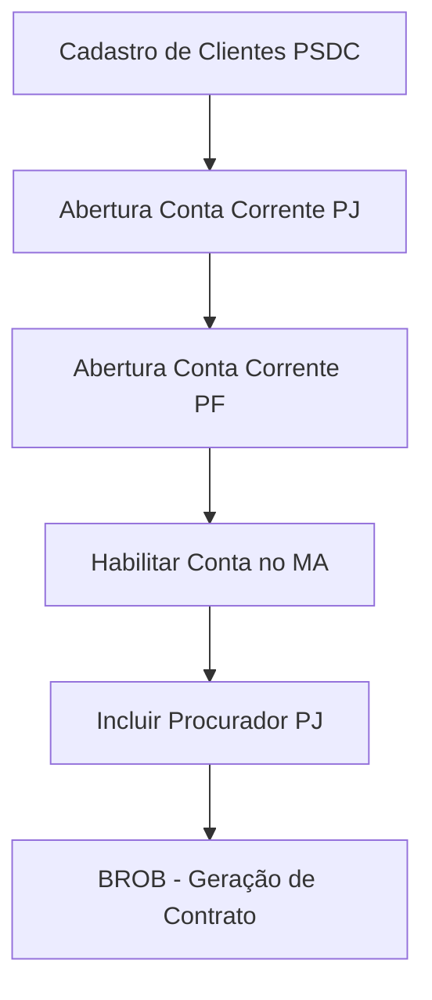

# Documentação – Etapas: Incluir Procurador PJ e BROB - Geração de Contrato
Jornada Card 005 – Massa de Dados PJ

---

## Sumário

- [1. Visão Geral](#1-visão-geral)
- [2. Incluir Procurador PJ](#2-incluir-procurador-pj)
- [3. BROB – Geração de Contrato](#3-brob--geração-de-contrato)
- [4. Fluxo Sequencial](#4-fluxo-sequencial)
- [5. Dados de Entrada e Saída](#5-dados-de-entrada-e-saída)
- [6. Pontos de Atenção](#6-pontos-de-atenção)

---

## 1. Visão Geral

Esta documentação detalha as duas etapas finais da jornada *Massa de Dados PJ* (Card 005):  
- **Incluir Procurador PJ**  
- **BROB – Geração de Contrato**  

Estas etapas são orquestradas no BFF após a habilitação da conta PJ, utilizando dados extraídos nas etapas anteriores do fluxo.

---

## 2. Incluir Procurador PJ

### Objetivo

Cadastrar um procurador vinculado à conta PJ aberta, estabelecendo poderes de movimentação mediante parâmetros predefinidos.

### Parâmetros e regras

- **Agência**: extraída do ZIP/log da etapa "Contas Correntes - PF"
- **Conta Corrente**: idem acima
- **CPF Procurador**: regra de negócio pode ser fixa ou extraída em variantes futuras
- **Forma de Assinatura**: geralmente *INDIVIDUAL*
- **Projeto JIRA**: preenchido para rastreabilidade interna

#### Exemplo de payload enviado ao workflow (builder)

```json
{
  "p_agencia": "448",
  "p_conta_corrente_proc": "501234",
  "p_cpf_procurador": "00000000191",
  "p_forma_ass": "INDIVIDUAL",
  "p_projeto_jira": "ENGPBIA-ENGENHARIA DE PLATAFORMA | BIA TECH"
}
```

### Observações

- O CPF do procurador atualmente pode ser estático ou proveniente de extração configurável futura.
- A inclusão ocorre somente após validação do sucesso nas etapas anteriores.

---

## 3. BROB – Geração de Contrato

### Objetivo

Submeter o job "BROB - Geração de Contrato" para formalização da abertura de conta com os dados consolidados, emitindo contratos/protocolos válidos.

### Parâmetros e regras

- **Agência**: proveniente da etapa PF
- **Conta Corrente**: idem
- **CPF Cliente**: concatenado conforme regra das etapas anteriores (ex: leftPad 9+2 dígitos)
- **Projeto JIRA**: controle interno

#### Exemplo de payload enviado ao workflow (builder)

```json
{
  "p_agcontr": "448",
  "p_contacontr": "501234",
  "p_cpf_brob": "04722143811",
  "p_projeto_jira": "ENGPBIA-ENGENHARIA DE PLATAFORMA | BIA TECH"
}
```

### Observações

- Se campos extraídos não atenderem requisitos (length, consistência), o job é rejeitado pelo TDM/DB2.
- Erros retornam mensagens padronizadas para troubleshooting rápido.

---

## 4. Fluxo Sequencial



---

## 5. Dados de Entrada e Saída

### Dados recebidos para cada etapa
| Etapa                  | Entrada                                       | Saída                                 |
|------------------------|-----------------------------------------------|---------------------------------------|
| Incluir Procurador PJ  | agência, conta, CPF procurador, forma ass.    | Status job, logs, id processamento    |
| BROB - Geração Contrato| agência, conta, cpfCliente, projeto JIRA      | Status job, logs, id processamento    |

### Possíveis falhas/validações

- Faltando agência/conta/CPF → falha e aborta fluxo
- CPF inválido → falha (BROB)
- Job do TDM com status explicitamente "Failed" → retorna mensagem de erro específica

---

## 6. Pontos de Atenção

- Todos os dados são extraídos/orquestrados automaticamente pelo BFF, exceto onde parâmetro precisa ser fixado.
- Eventuais ajustes futuros para regra de procuração devem ser centralizados no builder.
- O fluxo foi desenhado para fail-fast: ausência de dado crítico impede avanço.

---

**Este documento é somente informativo e não altera nenhuma lógica, rotina ou processo existente.**
