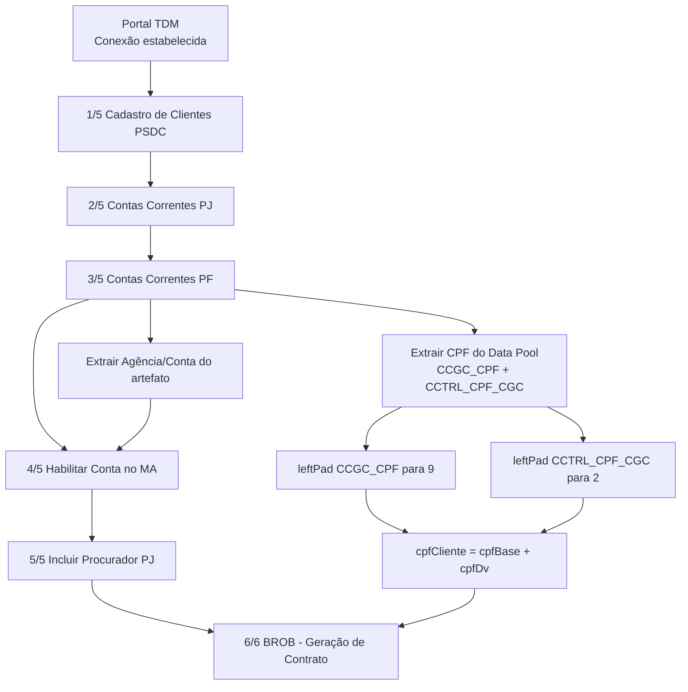

# Gráfico da Jornada — Massa de Dados PJ (ID: cta-005)

## Fluxo completo (Mermaid)



---

## Regras de composição do CPF (step 3/5)

- **CCGC_CPF** → `leftPad(9, '0')`
- **CCTRL_CPF_CGC** → `leftPad(2, '0')`
- **CPF final** → concatenação dos dois valores tratados

Exemplo:
- `47221438` + `11`  
- `047221438` + `11`  
- `cpfCliente = 04722143811`

---

## Versão simplificada (apresentação rápida)

```mermaid
flowchart LR
    S1[Cadastro PSDC] --> S2[Contas PJ] --> S3[Contas PF]
    S3 --> CPF[Gerar CPF<br/>leftPad(9)+leftPad(2)]
    CPF --> S4[Habilitar MA] --> S5[Incluir Procurador] --> S6[BROB Contrato]
