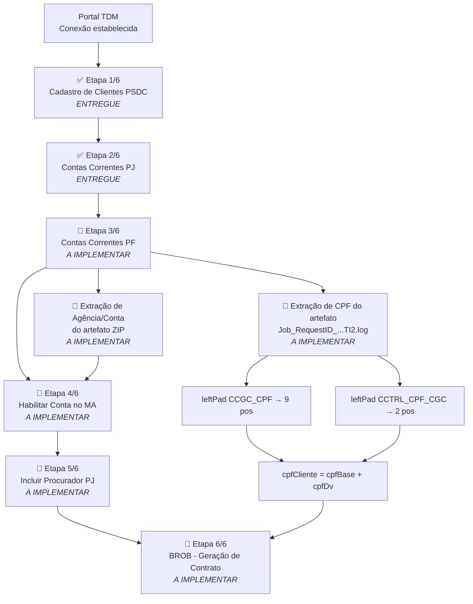

# Plano de Entrega — CTA-005 Massa de Dados PJ
## Etapas 3 a 6 (Etapas 1 e 2 já entregues)

> **Card:** CTA-005 — Massa de Dados PJ  
> **Projeto:** Abertura de Contas  
> **Versão:** 1.0  
> **Data do plano:** 2026-09-24  
> **Status das etapas 1 e 2:** ✅ Implementadas e em produção  
> **Premissa:** Nenhuma alteração nas etapas 1 e 2 — preservar execução e lógica existentes

---

## Visão geral do fluxo completo



---

## Status por etapa

| Etapa | Rotina TDM | Status | Builder |
|-------|-----------|--------|---------|
| 1/6 | Cadastro de Clientes PSDC | ✅ Entregue | `cadastro-clientes-psdc.builder.ts` |
| 2/6 | Contas Correntes PJ | ✅ Entregue | `contas-correntes-pj.builder.ts` |
| 3/6 | Contas Correntes PF | 🔴 A implementar | `contas-correntes-pf.builder.ts` |
| 4/6 | Habilitar Conta no MA | 🔴 A implementar | `habilitar-conta-ma-pj.builder.ts` |
| 5/6 | Incluir Procurador PJ | 🔴 A implementar | `incluir-procurador-pj.builder.ts` |
| 6/6 | BROB — Geração de Contrato | 🔴 A implementar | `brob-geracao-contrato.builder.ts` |

---

## Detalhamento das etapas a entregar

---

### 🔴 Etapa 3/6 — Contas Correntes PF

**Objetivo:** Abrir conta corrente PF vinculada ao CPF do cliente gerado pelas etapas anteriores.

**Builder:** `contas-correntes-pf.builder.ts`

#### Entradas necessárias
| Dado | Origem | Observação |
|------|--------|------------|
| Username (SSO) | Sessão Angular | Já disponível no fluxo atual |
| Dados de configuração TDM | Builder fixo | Já mapeados no builder |

#### Saída crítica (pós-execução)
Esta etapa gera um artefato `.zip` contendo o arquivo de log:
```
Job_<RequestID>_Data_Pool_Abertura de Conta Corrente PF_TI2.log
```

Desse log devem ser extraídas **duas variáveis de sessão**:

**a) Composição do CPF do cliente**

| Campo no log | Tabela | Regra | Exemplo |
|---|---|---|---|
| `CCGC_CPF` | `CLIENTE_AGENCIA` | `leftPad('0', 9)` | `47221438` → `047221438` |
| `CCTRL_CPF_CGC` | `CLIENTE_AGENCIA` | `leftPad('0', 2)` | `11` → `11` / `1` → `01` |

```
cpfCliente = leftPad(CCGC_CPF, 9, '0') + leftPad(CCTRL_CPF_CGC, 2, '0')
Exemplo: 047221438 + 11 = 04722143811
```

**b) Agência e conta para a etapa 4**

| Campo no log | Uso |
|---|---|
| Número da agência | Parâmetro de entrada da Etapa 4 — Habilitar Conta no MA |
| Número da conta | Parâmetro de entrada da Etapa 4 — Habilitar Conta no MA |

#### Dependências de implementação
- [ ] Integração com `artifact-extractor.ts` (BFF) para download e leitura do ZIP
- [ ] Parser do arquivo `.log` para extração de `CCGC_CPF` e `CCTRL_CPF_CGC`
- [ ] Lógica de leftPad (9 posições para CPF base, 2 posições para dígito verificador)
- [ ] Armazenamento de `cpfCliente` e `agencia`/`conta` para uso nas etapas seguintes
- [ ] Aguardar conclusão do job antes de tentar ler o artefato (polling)

---

### 🔴 Etapa 4/6 — Habilitar Conta no MA

**Objetivo:** Habilitar a conta corrente PF recém-criada no módulo MA (Mobile/Agência).

**Builder:** `habilitar-conta-ma-pj.builder.ts`

#### Entradas necessárias
| Dado | Origem | Observação |
|------|--------|------------|
| `agencia` | Artefato da Etapa 3 | Extraído do log `Job_<RequestID>_...TI2.log` |
| `conta` | Artefato da Etapa 3 | Extraído do log `Job_<RequestID>_...TI2.log` |
| Username (SSO) | Sessão Angular | Já disponível no fluxo atual |

#### Dependências de implementação
- [ ] Receber `agencia` e `conta` extraídos na etapa 3
- [ ] Passar esses valores como parâmetros ao builder
- [ ] Garantir que a etapa 3 tenha concluído com sucesso antes de iniciar esta etapa

---

### 🔴 Etapa 5/6 — Incluir Procurador PJ

**Objetivo:** Vincular procurador PJ à conta corrente criada.

**Builder:** `incluir-procurador-pj.builder.ts`

#### Entradas necessárias
| Dado | Origem | Observação |
|------|--------|------------|
| `agencia` | Artefato da Etapa 3 (via Etapa 4) | Reutilizar valor já capturado |
| `conta` | Artefato da Etapa 3 (via Etapa 4) | Reutilizar valor já capturado |
| Username (SSO) | Sessão Angular | Já disponível no fluxo atual |

#### Dependências de implementação
- [ ] Receber `agencia` e `conta` propagados pelas etapas anteriores
- [ ] Garantir que a etapa 4 tenha concluído com sucesso antes de iniciar esta etapa

---

### 🔴 Etapa 6/6 — BROB Geração de Contrato

**Objetivo:** Gerar o contrato do cliente via rotina BROB, usando o CPF composto na etapa 3.

**Builder:** `brob-geracao-contrato.builder.ts`

#### Entradas necessárias
| Dado | Origem | Observação |
|------|--------|------------|
| `cpfCliente` | Composto na Etapa 3 | `leftPad(CCGC_CPF,9,'0') + leftPad(CCTRL_CPF_CGC,2,'0')` |
| Username (SSO) | Sessão Angular | Já disponível no fluxo atual |

#### Dependências de implementação
- [ ] Receber `cpfCliente` gerado e armazenado na etapa 3
- [ ] Passar `cpfCliente` como parâmetro ao builder
- [ ] Garantir que a etapa 5 tenha concluído com sucesso antes de iniciar esta etapa

---

## Cadeia de dependências entre etapas

```
Etapa 1 ──► Etapa 2
                    │
                    ▼
              Etapa 3 ──► [Extrai CPF: cpfCliente]
                    │             │
                    │             └──────────────────► Etapa 6 (cpfCliente)
                    │
                    ▼
              [Extrai Agência/Conta]
                    │
                    ▼
              Etapa 4 ──► Etapa 5 ──► (sem outputs para outras etapas)
```

---

## Variáveis de sessão que devem ser propagadas

| Variável | Criada em | Usada em | Tipo |
|----------|-----------|----------|------|
| `cpfCliente` | Etapa 3 (extração do log) | Etapa 6 | `string` — 11 dígitos sem pontuação |
| `agencia` | Etapa 3 (extração do log) | Etapa 4, Etapa 5 | `string` |
| `conta` | Etapa 3 (extração do log) | Etapa 4, Etapa 5 | `string` |

---

## Premissas e restrições

1. **Não alterar etapas 1 e 2** — a lógica de submissão e polling das etapas PSDC e Contas PJ deve permanecer intocada.
2. **Execução sequencial obrigatória** — cada etapa só inicia após a anterior ser concluída com sucesso (status terminal do job TDM).
3. **Extração de artefato** — o BFF já possui infraestrutura em `artifact-extractor.ts`; a lógica de extração do CPF deve reutilizar esse serviço.
4. **Máximo 10 CNPJs por execução** — restrição da Etapa 1 (definida no `vtfnodeDesc`), não validada programaticamente, deve ser observada pelo operador.
5. **Ambiente TI2** — todas as etapas operam no ambiente `PCM2AB - NOVO TI` ou equivalente de testes integrados.
